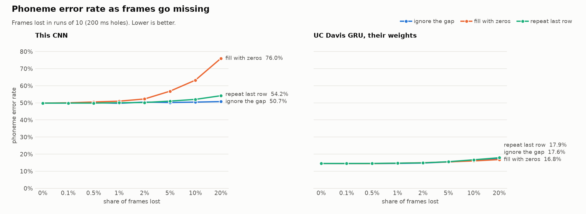

# decoder-latency

A small speech decoder trained on real brain recordings, run as a live stream and timed
one step at a time, next to the published UC Davis decoder on the same sentences.

The recordings are public: 256 electrodes in the speech motor cortex of one man with
ALS, while he tried to say sentences shown on a screen (Card et al. 2024). A decoder
turns those recordings into phonemes, the sounds that words are made of.

## Results in short

| | This CNN | UC Davis GRU, their weights |
|---|---|---|
| Phonemes wrong, same 267 sentences | 49.8% | 14.5% |
| Typical time for one step (a step is due every 80 ms) | 1.3 ms | 8.1 ms |
| Phonemes wrong with 20% of frames lost in 200 ms holes, filled with zeros | 76.0% | 16.8% |

The published model is far more accurate and still well inside the deadline. On a
laptop, accuracy is what separates the two, not time. The details and the limits are
below.

## What it is

- **Data:** the public UC Davis speech-BCI recordings (Card et al. 2024, Dryad
  doi:10.5061/dryad.dncjsxm85). One participant, 256 electrodes, 45 recording days.
  Each sentence is a table of 512 features per 20 ms row, plus the phonemes he was
  trying to say.
- **Model:** a small 1D CNN (`SmallCNN` in `model.py`), trained with CTC loss to turn
  the features into phonemes.
- **Live loop:** `stream.py` feeds a model one row at a time through a ring buffer and
  times every step: typical, p99 and worst, on the CPU and on the Mac's GPU.
- **Comparison:** the UC Davis baseline (a 5-layer GRU) with their published weights,
  rebuilt in `their_model.py` and put through the same accuracy, timing and
  dropped-frames tests.
- **Receive path:** `frames.py` sends rows as numbered frames with a CRC, and
  `drop_test.py` measures what happens to the error rate when frames go missing.

## What it is not

- Not any company's data, format or code. Everything here is public UC Davis data.
- Not embedded. It is Python on a Mac, replaying recordings. There is no implant, no
  radio link and no real-time operating system.
- Not a full speech system. It stops at phonemes: no language model, no words.
- One participant. Nothing here says how it would do on anyone else.
- The numbers are on the validation split. The test split has no public labels.
- I did not train the UC Davis model. Its weights are theirs. What is mine is the code
  that runs it, and that code is checked against their own training log (see Results).

## Set it up

```bash
git clone https://github.com/Maurya30/decoder-latency.git
```

```bash
cd decoder-latency
```

```bash
python3.12 -m venv .venv
```

```bash
.venv/bin/pip install -r requirements.txt
```

Then get two files from the Dryad page, https://doi.org/10.5061/dryad.dncjsxm85
(Dryad may wrap a download in a second zip):

- `t15_copyTask_neuralData.zip` (11 GB): unzip it into `data/`, so that
  `data/hdf5_data_final/` exists.
- `t15_pretrained_rnn_baseline.zip` (485 MB), only needed for the comparison: unzip it
  into `data/pretrained/`, so that `data/pretrained/t15_pretrained_rnn_baseline/` exists.

Training on 8 days needs about 3 GB of memory.

## Run it

```bash
.venv/bin/python check.py
.venv/bin/python train.py --model linear --days 8 --epochs 5
.venv/bin/python train.py --model cnn --days 8 --epochs 12 --noise 0.5
.venv/bin/python -I import_their_weights.py
.venv/bin/python evaluate.py
.venv/bin/python stream.py --fresh --models cnn their-gru
.venv/bin/python stream.py --paced --models cnn their-gru
.venv/bin/python drop_test.py
.venv/bin/python drop_test.py --burst 10
.venv/bin/python drop_test.py --model their-gru
.venv/bin/python drop_test.py --model their-gru --burst 10
```

Charts and numbers land in `runs/`.

## See it run

```bash
.venv/bin/python demo.py
```

Then open http://localhost:8765, pick a sentence and press Play. The page replays the
recording at real speed and shows three things as they happen: the frames arriving,
the phonemes each decoder hears, and the time every step took against the 80 ms
deadline. To watch the dropped-frames result, lose 20% of frames in runs of 10 and have
the receiver fill the holes with zeros.

It is a replay of recorded data on this computer, run through the same code as
everything else here. Nothing in it is live from a person.

## Results

Measured on 16 November 2026 on an Apple M5 laptop with other apps running.

### Accuracy

Phoneme error rate on the same 267 validation sentences, from the 8 most recent
recording days. Lower is better.

| Model | Trained on | Error rate |
|---|---|---|
| One-layer baseline, no context | 984 sentences, here | 280.0% |
| This CNN, 380 ms of context | 984 sentences, here, about 45 seconds | 49.8% |
| UC Davis GRU, their weights | all 45 days, by them | 14.5% |

The baseline is above 100% because it scores every 20 ms row on its own and ends up
adding far more phonemes than the sentence has.

Day by day:

| Day | Sentences | This CNN | UC Davis GRU, run here | Same model in their own log |
|---|---|---|---|---|
| 2024.07.21 | 46 | 42.6% | 4.8% | 4.7% |
| 2024.07.28 | 48 | 47.4% | 9.0% | 9.0% |
| 2025.01.10 | 23 | 58.4% | 24.2% | 24.1% |
| 2025.01.12 | 47 | 44.0% | 9.2% | 9.2% |
| 2025.03.14 | 24 | 62.1% | 30.8% | 30.6% |
| 2025.03.16 | 24 | 49.5% | 14.0% | 14.1% |
| 2025.03.30 | 30 | 56.9% | 21.6% | 21.5% |
| 2025.04.13 | 25 | 51.4% | 21.4% | 21.3% |

The last two columns are the check on `their_model.py`: their weights, run through the
code here, land within 0.2 points of what their own training log reports for each day.
(They ran it in 16-bit floats on NVIDIA GPUs; here it is 32-bit floats on a Mac.) Their
log gives 10.1% averaged over all their days, so these 8 recent days are harder than
their average.

One sentence, "It's kind of funny.":

```
truth        IH T S | K AY N D | AH V | F AH N IY |
this CNN     IH T S T | K N D | | HH AH V | S R N IY |
their GRU    IH T S | K AY N D | AH V | F AH N IY |
```

### Time for one step

Typical / p99 / worst, in ms. Both models owe one step every 80 ms, and no step was
late in this run. "Paced" means rows arrive every 20 ms like a real stream, so the
processor idles between steps. "Back to back" means the next step starts the moment
the last one ends.

| | this CNN | UC Davis GRU, their weights |
|---|---|---|
| Rows needed per step | 19 (380 ms) | 22 (440 ms), plus its memory |
| CPU, paced | 1.26 / 3.41 / 4.8 | 8.11 / 18.26 / 48.2 |
| GPU (MPS), paced | 2.36 / 5.54 / 8.3 | 5.91 / 10.61 / 19.5 |
| CPU, back to back | 0.13 / 0.22 / 2.3 | 1.89 / 3.04 / 5.4 |
| GPU (MPS), back to back | 0.44 / 1.00 / 5.9 | 1.71 / 3.41 / 9.5 |


I timed everything twice on the same day (the first run is in
`runs/experiments_run1.log`). The typical times mostly repeated: within 15% for six of
the eight rows. The worst cases did not. The CNN's worst back-to-back step on the CPU
was 11.4 ms in the first run and 2.3 ms in the second. The GRU's worst paced step on
the GPU was 136.9 ms in the first run, with 2 of 500 steps late, and 19.5 ms in the
second, with none late. Only the CNN rows are an exact repeat: in the first run the GRU
had random weights and no smoothing step.

### Dropped frames

Phoneme error rate when frames are lost in runs of 10 (200 ms holes), for three things
the receiver can do about a hole. The same frames are lost in every column.

| Frames lost | CNN: ignore the gap | CNN: fill with zeros | CNN: repeat last row | GRU: ignore the gap | GRU: fill with zeros | GRU: repeat last row |
|---|---|---|---|---|---|---|
| 0% | 49.8% | 49.8% | 49.8% | 14.5% | 14.5% | 14.5% |
| 1% | 49.7% | 51.0% | 50.1% | 14.6% | 14.7% | 14.7% |
| 5% | 50.2% | 56.8% | 51.0% | 15.4% | 15.4% | 15.6% |
| 10% | 50.4% | 63.3% | 52.0% | 16.2% | 16.0% | 16.7% |
| 20% | 50.7% | 76.0% | 54.2% | 17.6% | 16.8% | 17.9% |



Frames lost one at a time barely matter to either model: at 20% lost, the CNN stays
between 49.3% and 52.7% and the GRU between 15.6% and 16.8%
(`runs/drop_compare.png`).

## What stood out

- **On this laptop, time is not what separates the two models. Accuracy is.** Their
  model's step takes about six times longer than the CNN's when paced (8.1 ms against
  1.3 ms on the CPU), and its typical step is still about ten times inside the 80 ms
  deadline. It gets 14.5% of phonemes wrong where the CNN gets 49.8%. A laptop is far
  bigger than anything that could sit near an implant, and I have not measured smaller
  hardware.
- **Paced is slower than back to back.** The same CNN step took 0.13 ms back to back
  and 1.26 ms paced, in both runs. My guess is that the processor winds down while it
  waits for the next row. I have not tested that guess. Either way, the back-to-back
  number flatters the model, and the paced one is closer to a real stream.
- **I can measure a typical time on this laptop, not a worst case.** The typical
  numbers mostly repeated between runs and the worst ones moved by as much as eleven
  times, so the tail here says more about what else the laptop was doing than about
  the model. A deadline is about the worst case, and that needs a machine where
  nothing else gets in the way.
- **The GPU did not help the CNN.** When paced, the CPU was nearly twice as fast for it
  in both runs. For the GRU the GPU was a little faster.
- **Compute time is not the only delay.** Their smoothing averages each row with the
  4 rows on either side of it, so a step needs 22 rows, not 14, and the newest 80 ms
  of signal only partly reaches the model. That is in their published evaluation code.
  I do not know what their live system does.
- **How a hole gets patched matters a lot for the CNN and hardly at all for their
  model.** Filling 200 ms holes with zeros took the CNN from 50% to 76% at 20% loss,
  while skipping the missing time left it flat. Their model moved from 14.5% to
  between 16.8% and 17.9% whatever the receiver did, and zeros were slightly the best
  for it. My guess at why: they train with added noise and offsets and smooth the
  input, and the CNN never saw a flat stretch in training. I have not tested that.

## Files

| File | What it does |
|---|---|
| `data.py` | loads the recordings |
| `model.py` | the models trained here: a one-layer baseline and the CNN |
| `train.py` | training with CTC loss, phoneme error rate |
| `their_model.py` | the UC Davis GRU, rebuilt from their published code |
| `import_their_weights.py` | turns their published checkpoint into a plain weights file |
| `evaluate.py` | error rate of every model on the same sentences, day by day |
| `stream.py` | the live loop and the timing |
| `frames.py` | numbered frames with a CRC, and the receiver |
| `drop_test.py` | error rate against lost frames |
| `charts.py` | the charts |
| `demo.py`, `demo.html` | a local page that shows both decoders running live |
| `check.py` | checks the seven key pieces behave |

## Who wrote what

Built with Claude (AI). I wrote the CNN's layers, its forward pass and its
output-length function by hand. Claude wrote the rest: the data loading, the training
loop, the live loop and its timing, the frames and receiver, the rebuild of the UC
Davis model, the charts, and the demo page.
