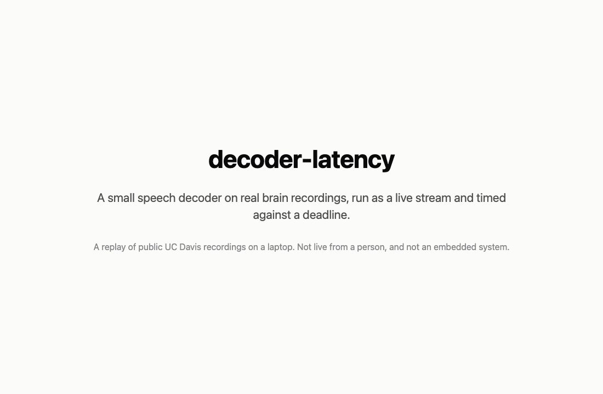
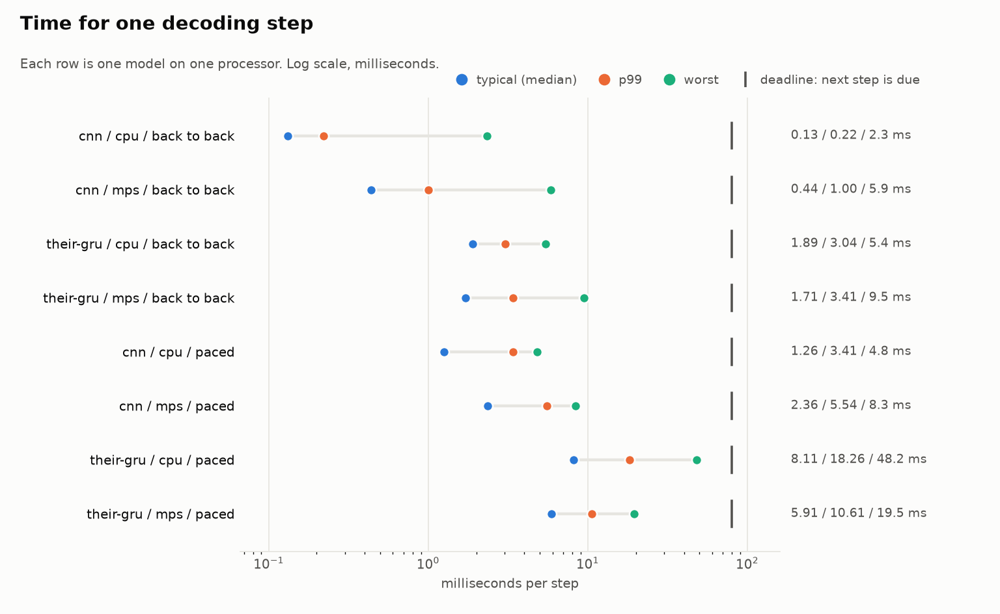
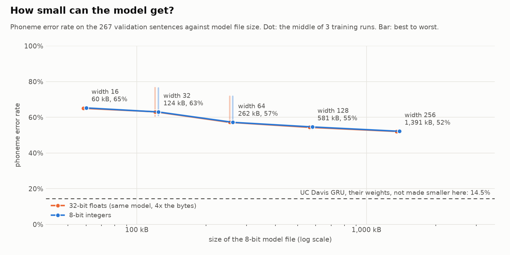

# speech-bci-decoder

A small speech decoder trained on real brain recordings, run as a live stream and timed
one step at a time, next to the published UC Davis decoder on the same sentences.



The recordings are public: 256 electrodes in the speech motor cortex of one man with
ALS, while he tried to say sentences shown on a screen (Card et al. 2024). A decoder
turns those recordings into phonemes, the sounds that words are made of.

## Results in short

| | This CNN | UC Davis GRU, their weights |
|---|---|---|
| Phonemes wrong, same 267 sentences | 49.8% | 14.5% |
| Typical time for one step (a step is due every 80 ms) | 1.3 ms | 8.1 ms |
| Phonemes wrong with 20% of frames lost in 200 ms holes, filled with zeros | 76.0% | 16.8% |

The published model is far more accurate and still well inside the deadline. On a
laptop, accuracy is what separates the two, not time. The details and the limits are
below.

**Next stage, 18 November 2026: getting the CNN ready for a microcontroller.** Stored as
8-bit integers it is a quarter of the size and no less accurate (49.9% against 49.8%).
A Rust version with no operating system and no heap gives identical output, and builds
for an ARM Cortex-M into 1.40 MB of flash and 8 kB of RAM. It has not run on a real
chip, so there is no microcontroller timing yet.
[The details](#getting-ready-for-a-microcontroller).

## What it is

- **Data:** the public UC Davis speech-BCI recordings (Card et al. 2024, Dryad
  doi:10.5061/dryad.dncjsxm85). One participant, 256 electrodes, 45 recording days.
  Each sentence is a table of 512 features per 20 ms row, plus the phonemes he was
  trying to say.
- **Model:** a small 1D CNN (`SmallCNN` in `model.py`), trained with CTC loss to turn
  the features into phonemes.
- **Live loop:** `stream.py` feeds a model one row at a time through a ring buffer and
  times every step: typical, p99 and worst, on the CPU and on the Mac's GPU.
- **Comparison:** the UC Davis baseline (a 5-layer GRU) with their published weights,
  rebuilt in `their_model.py` and put through the same accuracy, timing and
  dropped-frames tests.
- **Receive path:** `frames.py` sends rows as numbered frames with a CRC, and
  `drop_test.py` measures what happens to the error rate when frames go missing.
- **Microcontroller stage:** the CNN as 8-bit integers (`quantize.py`), narrower
  versions of it (`sizes.py`), and the same decoder in Rust, built for an ARM Cortex-M
  (`decoder-rs/`).

## Set it up

```bash
git clone https://github.com/Maurya30/speech-bci-decoder.git
```

```bash
cd speech-bci-decoder
```

```bash
python3.12 -m venv .venv
```

```bash
.venv/bin/pip install -r requirements.txt
```

Then get two files from the Dryad page, https://doi.org/10.5061/dryad.dncjsxm85
(Dryad may wrap a download in a second zip):

- `t15_copyTask_neuralData.zip` (11 GB): unzip it into `data/`, so that
  `data/hdf5_data_final/` exists.
- `t15_pretrained_rnn_baseline.zip` (485 MB), only needed for the comparison: unzip it
  into `data/pretrained/`, so that `data/pretrained/t15_pretrained_rnn_baseline/` exists.

Training on 8 days needs about 3 GB of memory.

The microcontroller stage also needs Rust (https://rustup.rs) with one extra compile
target, and optionally the QEMU emulator to run the ARM build:

```bash
rustup target add thumbv7em-none-eabihf
```

## Run it

```bash
.venv/bin/python check.py
.venv/bin/python train.py --model linear --days 8 --epochs 5
.venv/bin/python train.py --model cnn --days 8 --epochs 12 --noise 0.5
.venv/bin/python -I import_their_weights.py
.venv/bin/python evaluate.py
.venv/bin/python stream.py --fresh --models cnn their-gru
.venv/bin/python stream.py --paced --models cnn their-gru
.venv/bin/python drop_test.py
.venv/bin/python drop_test.py --burst 10
.venv/bin/python drop_test.py --model their-gru
.venv/bin/python drop_test.py --model their-gru --burst 10
```

The microcontroller stage, in order (`sizes.py` trains 15 small models and takes about
30 minutes):

```bash
.venv/bin/python quantize.py
.venv/bin/python sizes.py
.venv/bin/python rust_check.py --sizes
.venv/bin/python firmware_check.py
```

Charts and numbers land in `runs/`.

## See it run

```bash
.venv/bin/python demo.py
```

Then open http://localhost:8765, pick a sentence and press Play. The page replays the
recording at real speed and shows three things as they happen: the frames arriving,
the phonemes each decoder hears, and the time every step took against the 80 ms
deadline. To watch the dropped-frames result, lose 20% of frames in runs of 10 and have
the receiver fill the holes with zeros.

It is a replay of recorded data on this computer, run through the same code as
everything else here. Nothing in it is live from a person.

## Results

Measured on 16 November 2026 on an Apple M5 laptop with other apps running.

### Accuracy

Phoneme error rate on the same 267 validation sentences, from the 8 most recent
recording days. Lower is better.

| Model | Trained on | Error rate |
|---|---|---|
| One-layer baseline, no context | 984 sentences, here | 280.0% |
| This CNN, 380 ms of context | 984 sentences, here, about 45 seconds | 49.8% |
| UC Davis GRU, their weights | all 45 days, by them | 14.5% |

The baseline is above 100% because it scores every 20 ms row on its own and ends up
adding far more phonemes than the sentence has.

Day by day:

| Day | Sentences | This CNN | UC Davis GRU, run here | Same model in their own log |
|---|---|---|---|---|
| 2024.07.21 | 46 | 42.6% | 4.8% | 4.7% |
| 2024.07.28 | 48 | 47.4% | 9.0% | 9.0% |
| 2025.01.10 | 23 | 58.4% | 24.2% | 24.1% |
| 2025.01.12 | 47 | 44.0% | 9.2% | 9.2% |
| 2025.03.14 | 24 | 62.1% | 30.8% | 30.6% |
| 2025.03.16 | 24 | 49.5% | 14.0% | 14.1% |
| 2025.03.30 | 30 | 56.9% | 21.6% | 21.5% |
| 2025.04.13 | 25 | 51.4% | 21.4% | 21.3% |

The last two columns are the check on `their_model.py`: their weights, run through the
code here, land within 0.2 points of what their own training log reports for each day.
(They ran it in 16-bit floats on NVIDIA GPUs; here it is 32-bit floats on a Mac.) Their
log gives 10.1% averaged over all their days, so these 8 recent days are harder than
their average.

One sentence, "It's kind of funny.":

```
truth        IH T S | K AY N D | AH V | F AH N IY |
this CNN     IH T S T | K N D | | HH AH V | S R N IY |
their GRU    IH T S | K AY N D | AH V | F AH N IY |
```

### Time for one step

Typical / p99 / worst, in ms. Both models owe one step every 80 ms, and no step was
late in this run. "Paced" means rows arrive every 20 ms like a real stream, so the
processor idles between steps. "Back to back" means the next step starts the moment
the last one ends.

| | this CNN | UC Davis GRU, their weights |
|---|---|---|
| Rows needed per step | 19 (380 ms) | 22 (440 ms), plus its memory |
| CPU, paced | 1.26 / 3.41 / 4.8 | 8.11 / 18.26 / 48.2 |
| GPU (MPS), paced | 2.36 / 5.54 / 8.3 | 5.91 / 10.61 / 19.5 |
| CPU, back to back | 0.13 / 0.22 / 2.3 | 1.89 / 3.04 / 5.4 |
| GPU (MPS), back to back | 0.44 / 1.00 / 5.9 | 1.71 / 3.41 / 9.5 |



I timed everything twice on the same day (the first run is in
`runs/experiments_run1.log`). The typical times mostly repeated: within 15% for six of
the eight rows. The worst cases did not. The CNN's worst back-to-back step on the CPU
was 11.4 ms in the first run and 2.3 ms in the second. The GRU's worst paced step on
the GPU was 136.9 ms in the first run, with 2 of 500 steps late, and 19.5 ms in the
second, with none late. Only the CNN rows are an exact repeat: in the first run the GRU
had random weights and no smoothing step.

### Dropped frames

Phoneme error rate when frames are lost in runs of 10 (200 ms holes), for three things
the receiver can do about a hole. The same frames are lost in every column.

| Frames lost | CNN: ignore the gap | CNN: fill with zeros | CNN: repeat last row | GRU: ignore the gap | GRU: fill with zeros | GRU: repeat last row |
|---|---|---|---|---|---|---|
| 0% | 49.8% | 49.8% | 49.8% | 14.5% | 14.5% | 14.5% |
| 1% | 49.7% | 51.0% | 50.1% | 14.6% | 14.7% | 14.7% |
| 5% | 50.2% | 56.8% | 51.0% | 15.4% | 15.4% | 15.6% |
| 10% | 50.4% | 63.3% | 52.0% | 16.2% | 16.0% | 16.7% |
| 20% | 50.7% | 76.0% | 54.2% | 17.6% | 16.8% | 17.9% |


Frames lost one at a time barely matter to either model: at 20% lost, the CNN stays
between 49.3% and 52.7% and the GRU between 15.6% and 16.8%
(`runs/drop_compare.png`).

## What stood out

- **On this laptop, time is not what separates the two models. Accuracy is.** Their
  model's step takes about six times longer than the CNN's when paced (8.1 ms against
  1.3 ms on the CPU), and its typical step is still about ten times inside the 80 ms
  deadline. It gets 14.5% of phonemes wrong where the CNN gets 49.8%. A laptop is far
  bigger than anything that could sit near an implant, and I have not measured smaller
  hardware.
- **Paced is slower than back to back.** The same CNN step took 0.13 ms back to back
  and 1.26 ms paced, in both runs. My guess is that the processor winds down while it
  waits for the next row. I have not tested that guess. Either way, the back-to-back
  number flatters the model, and the paced one is closer to a real stream.
- **I can measure a typical time on this laptop, not a worst case.** The typical
  numbers mostly repeated between runs and the worst ones moved by as much as eleven
  times, so the tail here says more about what else the laptop was doing than about
  the model. A deadline is about the worst case, and that needs a machine where
  nothing else gets in the way.
- **The GPU did not help the CNN.** When paced, the CPU was nearly twice as fast for it
  in both runs. For the GRU the GPU was a little faster.
- **Compute time is not the only delay.** Their smoothing averages each row with the
  4 rows on either side of it, so a step needs 22 rows, not 14, and the newest 80 ms
  of signal only partly reaches the model. That is in their published evaluation code.
  I do not know what their live system does.
- **How a hole gets patched matters a lot for the CNN and hardly at all for their
  model.** Filling 200 ms holes with zeros took the CNN from 50% to 76% at 20% loss,
  while skipping the missing time left it flat. Their model moved from 14.5% to
  between 16.8% and 17.9% whatever the receiver did, and zeros were slightly the best
  for it. My guess at why: they train with added noise and offsets and smooth the
  input, and the CNN never saw a flat stretch in training. I have not tested that.

## Getting ready for a microcontroller

Measured on 18 November 2026, on the same Apple M5 laptop. Nothing in this section has
run on a real microcontroller. The last part says what that leaves open.

A microcontroller is a small, low-power chip with its own memory built in: flash, which
keeps the program and here mostly the model's weights, and RAM, the working memory.
Both are small, from kilobytes to a few megabytes. This stage asks what it takes to make
the CNN fit one and run on one. It is the CNN, not the UC Davis model, because the CNN
is the one small enough to try.

| | |
|---|---|
| Weights as 8-bit integers, not 32-bit floats | 5,549,220 bytes down to 1,391,044 |
| Phonemes wrong, same 267 sentences | 49.8% as floats, 49.9% as 8-bit |
| The same decoder in Rust, no operating system, no heap | identical output on all 66,415 steps |
| Built for an ARM Cortex-M | 1,398,816 bytes of flash, 8,056 bytes of RAM |
| Time for one step on a real microcontroller | not measured: no board yet |

### 8-bit weights

`quantize.py` stores every weight as one signed byte and does the sums between layers in
whole numbers, so the model needs no float maths after its input has been scaled. The
scaling is set from the training sentences. The validation sentences are only used to
score the result.

| | 32-bit floats | 8-bit integers |
|---|---|---|
| Size of the weights | 5,549,220 bytes | 1,391,044 bytes |
| Phonemes wrong, same 267 sentences | 49.8% | 49.9% |

The two versions pick the same phoneme on 99.6% of the 66,415 output steps. The tenth
of a point between them is smaller than the gap between two training runs of the same
model (next table).

### How small can it get

Width is the number of channels in the CNN's two hidden layers. The CNN above is 256
wide. `sizes.py` trains five widths, three times each from different random starting
points, converts every model to 8-bit and scores it on the same 267 sentences.

| Width | Flash: the 8-bit weights | RAM while running | Multiplications per step | Phonemes wrong as 8-bit: middle run (best to worst) | As floats |
|---|---|---|---|---|---|
| 256 | 1,391,044 bytes | 5,800 bytes | 2,304,256 | 52.2% (51.1 to 52.8) | 52.1% (51.0 to 52.5) |
| 128 | 580,932 bytes | 4,776 bytes | 1,037,440 | 54.6% (53.3 to 54.9) | 54.4% (53.2 to 54.9) |
| 64 | 261,892 bytes | 4,264 bytes | 490,048 | 57.2% (57.1 to 71.7) | 57.2% (57.0 to 71.7) |
| 32 | 123,876 bytes | 4,008 bytes | 237,856 | 63.0% (60.9 to 76.5) | 63.1% (60.7 to 76.6) |
| 16 | 60,244 bytes | 3,880 bytes | 117,136 | 65.3% (64.4 to 65.6) | 65.1% (64.6 to 65.7) |



RAM is the working memory of the Rust decoder in the next part. The multiplications are
counted from the model's shape, not measured.

- **There is no cliff.** Accuracy slides as the model shrinks. Half the width is 2.4
  times less flash for about 2 points. The narrowest model is 23 times smaller than the
  widest for 13 points.
- **The middle widths are unreliable.** At widths 64 and 32, one run in three came out
  far worse than the other two (71.7% and 76.5%). Three runs are too few to say how
  often that happens.
- **8-bit costs nothing at any width.** Across all 15 models the 8-bit version is within
  0.3 points of the float one.
- **RAM hardly changes.** Most of it is the 7 newest input rows (3,584 bytes), which do
  not depend on the width.
- **The first layer is where the size is.** It reads 512 features at 7 points in time
  for every channel, so at width 256 it holds 66% of the weights and does 80% of the
  multiplications. A narrower model shrinks it only in step with everything else. A
  first layer that mixed the 512 features down before looking across time should cut
  it further. I have not tried that.

How long each model trains is decided without the validation sentences. A tenth of the
training sentences (98) are held back. Each run keeps the weights from the epoch that
did best on those, and stops after 30 epochs with no improvement or at 100 epochs. The
256-wide row is a little worse than the CNN above (52% against 49.8%). The likely
reason is that these runs learn from 886 sentences, not 984. The two widest models
were at their best after 12 to 24 epochs. The narrowest needed 46 to 99.

My first attempt gave every width the same 12 epochs, the recipe of the CNN above. That
made the narrow models look much worse than they are: width 16 came out between 77% and
92%, where it reaches 65% when it gets the epochs it needs. That attempt is kept in
`runs/sizes_12_epochs.json` as a warning, not as a result.

The weights of these 15 models are not in the repository (`sizes.py` trains them again
in about 30 minutes). The 8-bit file from the first run of each narrower width is, so
that the Rust check below works without retraining.

### The decoder in Rust

`decoder-rs/src/lib.rs` is the 8-bit model's forward pass written for a chip with no
operating system. It is `no_std` (it uses nothing from an operating system: no files, no
clock, no threads), it never allocates memory while running, and it has no `unsafe`
code and no dependencies. All its working memory is one fixed-size struct, so the RAM
it needs is known when it is compiled. The weights are read in place and never copied.

It also does less work per step than the Python loop. One step looks at 19 rows, and a
new step is due every 4 rows. The first layer turns the 19 rows into 7 columns, and 5 of
those 7 were already worked out for the step before. The Rust decoder keeps them and
works out only the 2 new ones. For the 256-wide model that is 2.3 million multiplications
a step in place of 6.9 million (counted, not measured).

**It gives the same answer.** `rust_check.py` sends all 267 validation sentences through
it one row at a time and compares every score with the Python 8-bit model: 66,415 output
steps, 41 scores each, all identical. Inside the test every step is also redone from
scratch, without the kept columns, and that agrees too. To show the check is able to
fail, the script also flips one bit of one weight in a copy of the model: 29 of one
sentence's 249 steps then differ.

**Time for one step on the laptop.** Typical / p99 / worst, in ms, measured the same way
as the table further up. The deadline is 80 ms.

| | Paced | Back to back |
|---|---|---|
| Rust, 8-bit, one thread: the live loop, which keeps the first layer's columns | 0.25 / 0.37 / 0.9 | 0.030 / 0.035 / 0.04 |
| Rust, 8-bit, one thread: the whole window redone every step | 0.73 / 0.96 / 1.1 | 0.083 / 0.096 / 0.12 |
| PyTorch, floats, 4 threads: the CNN as timed above, timed again in this run | 1.55 / 2.34 / 3.2 | 0.131 / 0.143 / 1.1 |

All three rows come from one run on 18 November, on the same rows of the recording. No
step was late in any of them.

- Keeping the columns makes a step 2.8 to 2.9 times faster. The count of multiplications
  says 3.0.
- Redone from scratch every step, the Rust decoder is about twice as fast as PyTorch on
  this model when paced. With the columns kept it is about six times as fast.
- The paced numbers moved between runs here too. An earlier run the same afternoon gave
  0.22 and 0.51 ms for the two Rust rows. That run was not saved.
- None of this is a microcontroller number. The laptop's processor has vector
  instructions that do many multiply-adds at once, and the laptop build uses them
  (`sdot`, in its disassembly). The Cortex-M build below does them one at a time.

The four narrower models pass the same check (the first run of each width), and their
timings are in `runs/rust.json`. The crate also has its own unit tests:
`cargo test --release` in `decoder-rs/`.

### Built for an ARM Cortex-M

`decoder-rs/cortex-m/` is the same decoder linked into a bare-metal image: a complete
program for a chip with no operating system under it. It is built for
`thumbv7em-none-eabihf`, which is the instruction set of ARM's Cortex-M4 and M7
processors with a float unit. That is a family of processors, not a board I have chosen.
The sizes below are read from the linked image by `firmware_check.py`.

| | Bytes | Where |
|---|---|---|
| The model's weights | 1,391,044 | flash |
| Code and constants: the decoder, the startup code and a self-test | 6,748 | flash |
| Vector table (where the chip finds its start address and interrupt handlers) | 1,024 | flash |
| **Flash in total** | **1,398,816** | |
| The decoder's working memory | 5,800 | RAM |
| One incoming row of features, as floats | 2,048 | RAM |
| The stack at its deepest | 208 | RAM |
| **RAM in total** | **8,056** | |

Flash is the tight one, not RAM: 99.4% of the flash is weights, and everything that
changes while it runs fits in 8 kB.

To check that the ARM build computes the same thing, the image carries a self-test and
`firmware_check.py` runs it in QEMU, an emulator, set up as a Cortex-M4. The test pushes
made-up rows through the decoder for 200 output steps and prints a checksum of every
score. Python's 8-bit model, given the same rows, produces the same checksum. The stack
depth was measured in that run too.

The emulator shows that the ARM build starts up and gets the right answer. It is not a
timing. An emulator's speed says nothing about a chip's, so no time was taken from it.

### What this does not show yet

- **No real board, so no microcontroller timing.** This is the number that matters and
  it is missing. What can be said on paper: the ARM build spends two byte loads and one
  multiply-accumulate on each multiplication (read from its disassembly). Arm's
  Cortex-M4 manual (DDI 0439B) gives 2 cycles for a load, fewer when loads follow each
  other, and 1 for that multiply-accumulate, so 3 to 5 cycles each. At 2.3 million
  multiplications a step that is 7 to 12 million cycles, which fits in 80 ms only on a
  chip clocked above roughly 90 to 145 MHz with nothing else to do. That is arithmetic
  from a manual, not a measurement. It also leaves out how fast a chip can read 1.4 MB
  of weights out of its flash every step, which could matter as much.
- **No target chosen.** Cortex-M4/M7 is my guess at the right family. If the real target
  is something else, the 8-bit model carries over. How much of the Rust and of the
  numbers above carries over depends on what it is.
- **Not tuned for ARM.** This is plain Rust as the compiler builds it. Arm's CMSIS-NN
  library has hand-tuned versions of these loops. I have not tried it or compared.
- **Only the decoder.** The 512 features per row arrive ready-made from the dataset.
  Turning raw electrode signals into those features is work a real device also has to
  do, and none of it is here.
- **The model that fits is the inaccurate one.** It gets about 50% of phonemes wrong
  where the UC Davis GRU gets 14.5%. Their model uses 32.8 million weights at a time,
  24 times this CNN, and I have not converted it to 8-bit or ported it. Making an
  accurate model small is the harder problem, and this stage does not touch it.
- **No power or heat measurement.**
- **The laptop timings are typical cases**, for the same reason as before: the worst
  case on a laptop mostly measures what else the laptop was doing.

## Files

| File | What it does |
|---|---|
| `data.py` | loads the recordings |
| `model.py` | the models trained here: a one-layer baseline and the CNN |
| `train.py` | training with CTC loss, phoneme error rate |
| `their_model.py` | the UC Davis GRU, rebuilt from their published code |
| `import_their_weights.py` | turns their published checkpoint into a plain weights file |
| `evaluate.py` | error rate of every model on the same sentences, day by day |
| `stream.py` | the live loop and the timing |
| `frames.py` | numbered frames with a CRC, and the receiver |
| `drop_test.py` | error rate against lost frames |
| `charts.py` | the charts |
| `demo.py`, `demo.html` | a local page that shows both decoders running live |
| `check.py` | checks the key pieces behave, without needing the dataset |
| `quantize.py` | turns a trained CNN into 8-bit integers and scores float against 8-bit |
| `sizes.py` | trains narrower CNNs and builds the size and accuracy table |
| `decoder-rs/src/lib.rs` | the 8-bit decoder in Rust: no operating system, no heap |
| `decoder-rs/src/bin/host.rs` | the laptop test bench around it |
| `rust_check.py` | checks the Rust decoder against Python score by score, and times it |
| `decoder-rs/cortex-m/` | the decoder as an ARM Cortex-M image with a self-test |
| `firmware_check.py` | builds that image, reads its flash and RAM, runs it in QEMU |
